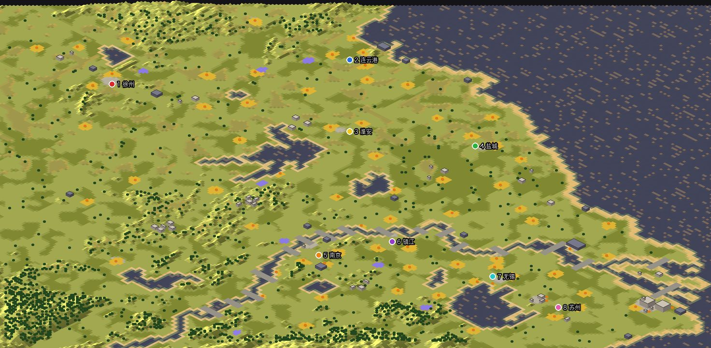
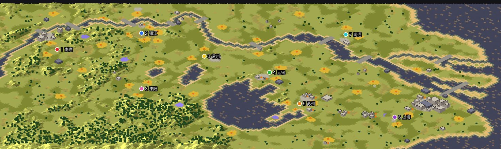
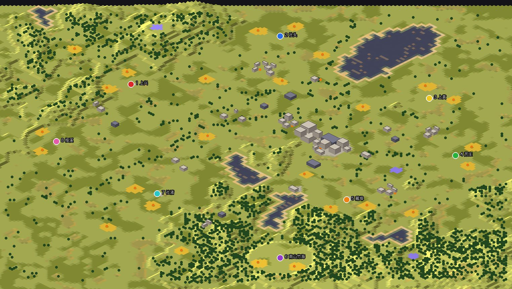
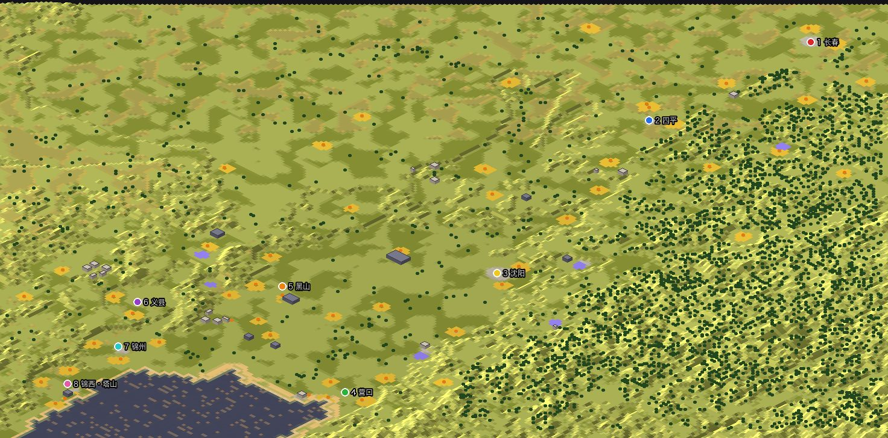
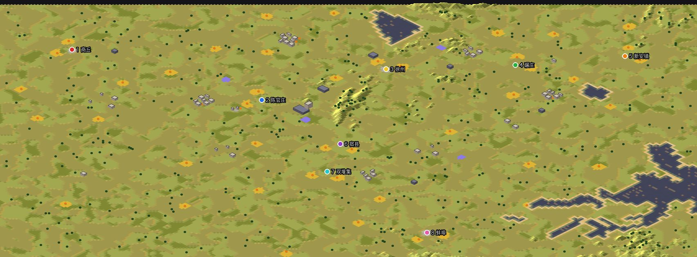
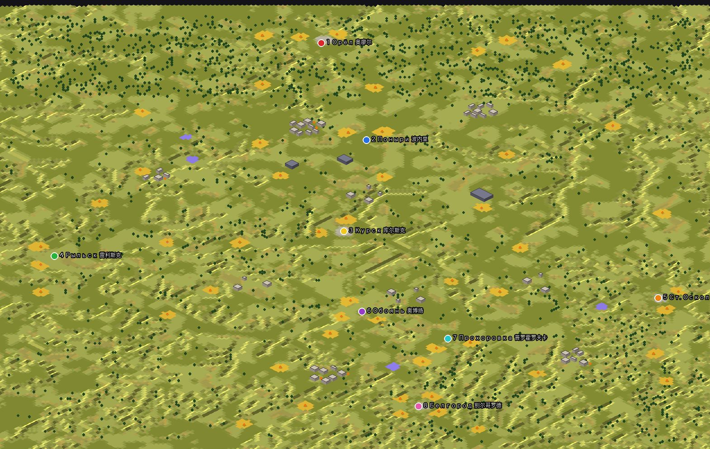
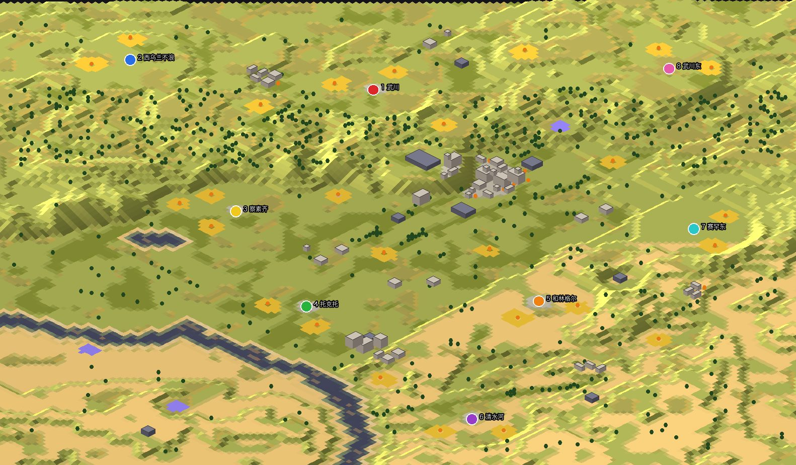
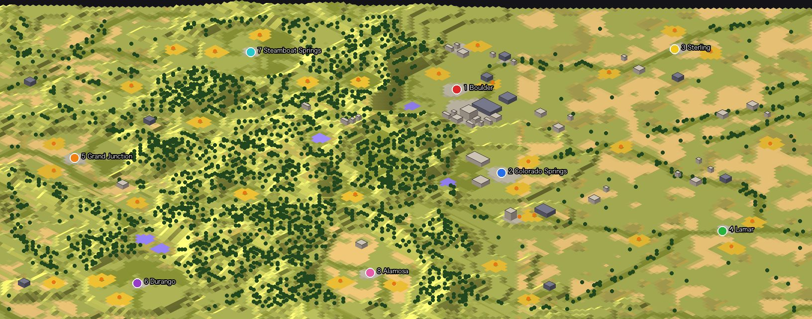
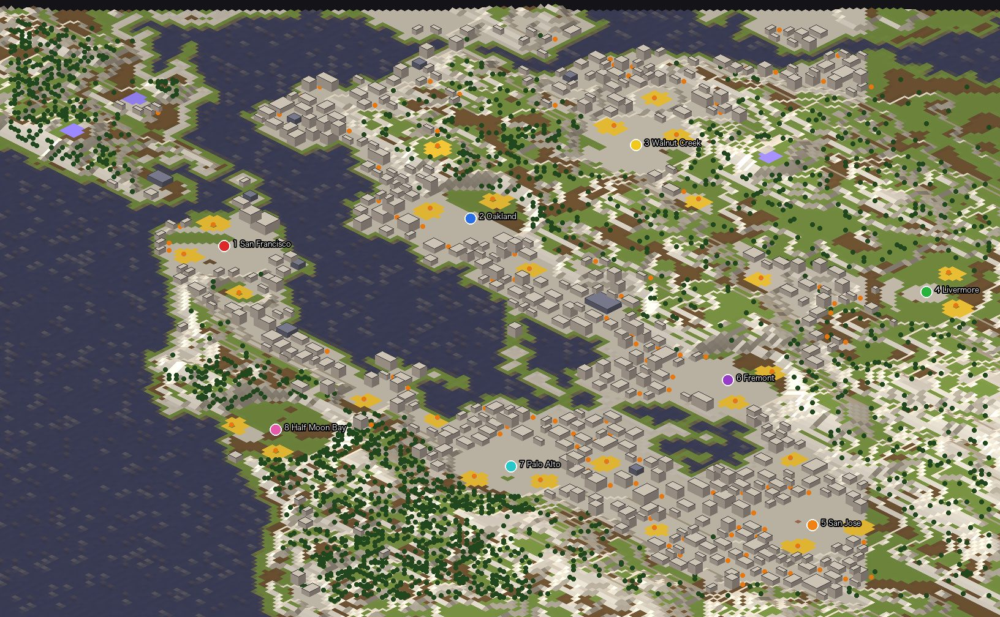

# RA2 真实地形地图生成器

这个项目用真实世界的地理数据，为《红色警戒 2：尤里的复仇》自动生成多人对战地图（`.mpr`）。用到的数据有三类：

- 高程和水深：AWS Terrain Tiles
- 湖泊和河道：OpenStreetMap、Natural Earth
- 城市、道路、出生点位置：手工整理

生成器把海拔换算成 RA2 的地形高度和坡道，用海岸拼接规则画出水面和岸线，再按真实位置放置城市建筑、矿区、科技建筑和桥梁。

**现成的地图在 [`maps/`](maps/) 目录，下载后放进游戏目录即可。** 每张都是 8 人图。

## 地图一览

下面的图都是生成器渲染出的游戏内斜视视角，编号圆点是玩家出生点。

### 江苏
长江把苏北四家和苏南四家隔开，过江只能走 17 座按真实位置建造的长江大桥，从铜陵一直到崇启大桥和上海长江大桥。`maps/jiangsu.mpr`



### 苏南 + 上海
南京到东海，包括太湖和长江口，长江上有 10 座真实位置的大桥，崇明是岛。`maps/sunan.mpr`



### 溧阳
长荡湖、天目湖、南山竹海，8 个乡镇围绕溧阳城区。`maps/liyang.mpr`



### 辽沈战役 (1948)
地图包括辽西走廊、锦州、塔山、黑山-大虎山、沈阳和被围困的长春，铁路按 1948 年的北宁线和中长线画出。`maps/liaoshen.mpr`



### 淮海战役 (1948-49)
以徐州为中心，津浦铁路和陇海铁路在这里交叉。碾庄、双堆集、陈官庄三个围歼地都是出生点，地图上还有微山湖、骆马湖和洪泽湖。`maps/huaihai.mpr`



### 库尔斯克战役 (1943)
库尔斯克突出部：北面是奥廖尔和波内里，南面是别尔哥罗德、奥博扬和普罗霍罗夫卡，地形是开阔的黑土高原。`maps/kursk.mpr`



### 呼和浩特
大青山、土默川平原和黄河。`maps/hohhot.mpr`



### Colorado
整个科罗拉多州：西半部是落基山脉，东半部是大平原。`maps/colorado.mpr`



### San Francisco Bay Area
旧金山湾区，使用城市地形，有城市街区和地标建筑。`maps/bayarea.mpr`



## 自己生成

```sh
python3 gen.py jiangsu          # 生成 out/jiangsu/jiangsu.mpr 和预览图
python3 validate.py out/jiangsu/jiangsu.mpr
python3 render.py jiangsu 4     # 渲染上面那样的斜视图
```

每张地图的设置都在 `regions/<name>.py` 里，包括范围、出生点、矿区、城市、道路、水面和桥梁。依赖 numpy、Pillow 和 matplotlib。

仓库里没有 `data/` 和 `ref/` 两个目录，需要自备：

- `data/`：高程瓦片和 OSM 数据。
- `ref/`：游戏的地形集定义、官方地图样本，以及 FinalAlert 2 的源码。
