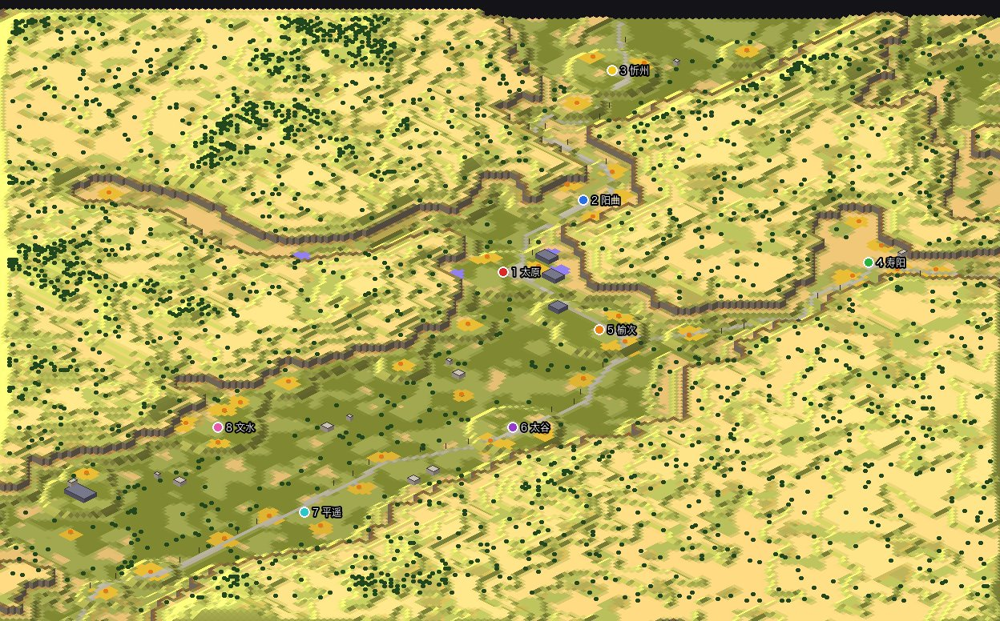
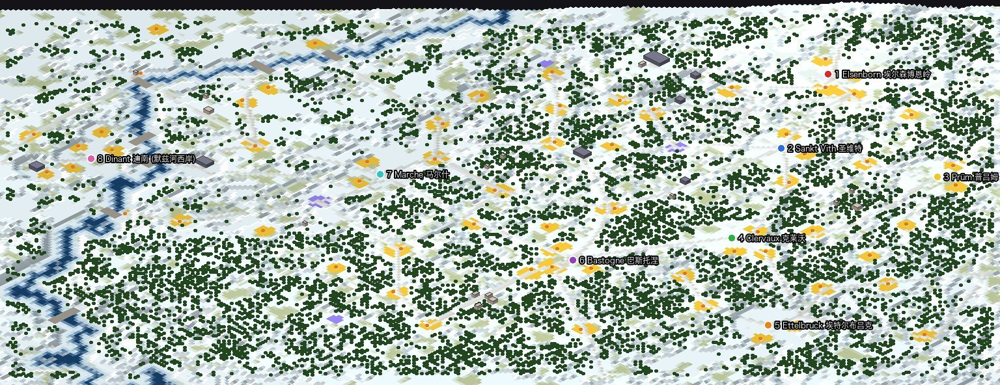
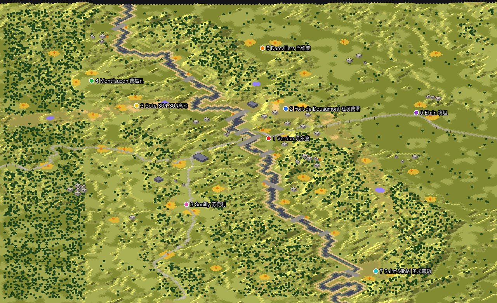
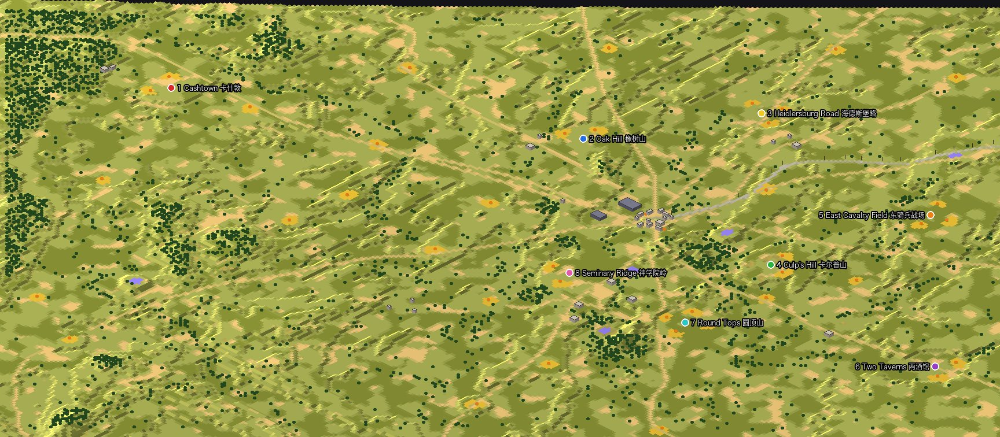

# RA2 真实地形地图生成器

这个项目用真实世界的地理数据，为《红色警戒 2：尤里的复仇》自动生成多人对战地图（`.mpr`）。用到的数据有三类：

- 高程和水深：AWS Terrain Tiles
- 湖泊和河道：OpenStreetMap、Natural Earth
- 城市、道路、出生点位置：手工整理

生成器把海拔换算成 RA2 的地形高度和坡道，用海岸拼接规则画出水面和岸线，再按真实位置放置城市建筑、矿区、科技建筑和桥梁。

**现成的地图在 [`maps/`](maps/) 目录，下载后放进游戏目录即可。** 每张都是 8 人图。

## 地图一览

下面的图都是生成器渲染出的游戏内斜视视角，编号圆点是玩家出生点。

### 江苏
长江把苏北四家和苏南四家隔开，过江只能走 17 座按真实位置建造的长江大桥，从铜陵一直到崇启大桥和上海长江大桥。以苏北灌溉总渠一线（秦岭-淮河线）为界，南边是水田，北边是旱地。`maps/jiangsu.mpr`


### 苏南 + 上海
南京到东海，包括太湖和长江口，长江上有 10 座真实位置的大桥，崇明是岛。按江南的湿润气候，平原以水田为主，村庄周围有树林。`maps/sunan.mpr`


### 溧阳
长荡湖、天目湖、南山竹海，8 个乡镇围绕溧阳城区。`maps/liyang.mpr`


### 辽沈战役 (1948)
地图包括辽西走廊、锦州、塔山、黑山-大虎山、沈阳和被围困的长春，铁路按 1948 年的北宁线、中长线和各条支线画出。原版红警2没有铁轨地块，所以铁路用一条压平的路基（铺装地面）表示，旁边每隔 6 格立一根电线杆；路基按沿线平均高度找平，只在换高度的地方有一格坡。战役打到 11 月初，东北已经下了初雪，所以用雪地地形，地里还露着高粱茬。`maps/liaoshen.mpr`


### 淮海战役 (1948-49)
以徐州为中心，津浦铁路和陇海铁路在这里交叉。碾庄、双堆集、陈官庄三个围歼地都是出生点，地图上还有微山湖、骆马湖和洪泽湖。陈官庄被围期间连降大雪，所以用雪地地形。`maps/huaihai.mpr`


### 库尔斯克战役 (1943)
库尔斯克突出部：北面是奥廖尔和波内里，南面是别尔哥罗德、奥博扬和普罗霍罗夫卡，地形是开阔的黑土高原。`maps/kursk.mpr`


### 太原战役 (1948–49)
"表里山河"：晋中盆地被吕梁山和太行山围住，山地做成悬崖高原，地面部队上不去，进出只有四个关口：北面同蒲北段过石岭关通忻州，东面沿正太铁路通寿阳，南面介休以南的汾河峡口（晋中战役时徐向前部从临汾北上走的就是这条路），西面汾河峡谷通古交煤田。太原城东的东山四大要塞（小窑头、牛驼寨、山头、淖马）在悬崖前的低丘上，有前哨站和宝石矿，1948 年秋天决定战局的争夺就在这里。武宿机场失守后阎锡山的空运就断了。铁路画了同蒲线和正太线。`maps/taiyuan.mpr`



### 突出部战役 (1944)
地图从埃尔森博恩岭和施内艾费尔一直到默兹河，巴斯托涅和圣维特是全图的两个公路枢纽。阿登高原大半是密不透风的云杉林，坦克离开公路几乎寸步难行，所以按 1944 年的路网画了 34 条公路（包括派佩尔战斗群的进军路线、卢森堡的"天际线公路"和巴顿北上解围走的阿尔隆公路），谁控制路口谁就控制战场。默兹河是德军的最终目标，按 OpenStreetMap 的河道做成真实水面，只有迪南、纪韦、伊沃尔、那慕尔、昂代讷、于伊等处的桥可以过河；有一家起点在西岸。斯塔沃洛和弗朗科尔尚的燃料库（派佩尔始终没拿到的油料）是油井，Foy-Notre-Dame 标出德军最远推进点。12 月的阿登是多年来最冷的冬天，用雪地地形。`maps/ardennes.mpr`



### 凡尔登战役 (1916)
地图包括马斯河谷和凡尔登城、右岸默兹高地上的杜奥蒙堡、沃堡、苏维尔堡等要塞环、左岸的死人山和 304 高地，德军一侧是蒙福孔、当维莱、埃坦和沃夫尔平原，以及横跨马斯河的圣米耶勒突出部。马斯河是真实水面，只能从 10 座桥过河；法军的生命线"神圣之路"从南边经苏伊利司令部通到凡尔登，铁路是经凡尔登通往埃坦和梅斯的干线。1916 年的战线两侧是弹坑和泥浆，几乎没有树，前线上被毁的村庄也不放房子；宝石矿放在死人山、考尔森林、莱塞帕尔热和沃夸几处争夺最激烈的高地。`maps/verdun.mpr`



### 葛底斯堡战役 (1863)
十条大路在宾夕法尼亚的一座小镇交汇，南北两军沿着这些路走来，在这里撞上了。地图包括"鱼钩"阵地（卡尔普山—公墓山—公墓岭—圆顶山）、对面的神学院岭和皮克特冲锋走过的那片开阔田野，西北是橡树山和 McPherson 岭，西边是南山脚下的卡什敦。真实高差只有约 40 m，所以把几座关键山头的起伏放大了几倍，让卡尔普山、小圆顶、大圆顶能从田野里明显凸出来，农田则基本保持平坦，方便展开部队。12 条历史道路按 OSM 路线画成土路，东去汉诺威的铁路画成路基加电线杆，小镇以西未铺轨的"铁路路堑"画成土路。宝石矿放在高水位线、魔鬼穴、Benner's Hill 等处，桃园和麦田一带是农庄。`maps/gettysburg.mpr`



### 呼和浩特
大青山、土默川平原和黄河。`maps/hohhot.mpr`


### Colorado
整个科罗拉多州：东半部是大平原，西半部是落基山脉。落基山被做成一整块高原，四周是游戏原版的悬崖块，比周围高 4 级，往里一直升到 13 级（游戏上限是 14 级）。地面部队上不去也翻不过，东西两边只有三条路相通：
- **I-70**（中线）：丹佛 → Idaho Springs → Eisenhower 隧道 → Vail → Glenwood 峡谷 → Grand Junction
- **北线**：Loveland → Estes Park → Trail Ridge Road（落基山国家公园）→ Granby → Kremmling → Rabbit Ears 山口 → Steamboat Springs
- **南线 US-160**：Walsenburg → La Veta 山口 → 圣路易斯谷（Alamosa）→ Wolf Creek 山口 → Pagosa Springs → Durango

每条路都是两侧夹着悬崖的峡谷，路面约 7 格宽，三条路在山里互不相通。山口上有宝石矿（Idaho Springs、Frisco、Lulu City、Summitville），所以过山的路本身就值得争夺。东边 4 家（Boulder、Colorado Springs、Sterling、Lamar），西边 3 家（Grand Junction、Durango、Steamboat Springs），Alamosa 一家在圣路易斯谷里，只能走南线进出。`maps/colorado.mpr`


### San Francisco Bay Area
旧金山湾区，使用城市地形，有城市街区和地标建筑。`maps/bayarea.mpr`


## 自己生成

```sh
python3 gen.py jiangsu          # 生成 out/jiangsu/jiangsu.mpr 和预览图
python3 validate.py out/jiangsu/jiangsu.mpr
python3 render.py jiangsu 4     # 渲染上面那样的斜视图
```

每张地图的设置都在 `regions/<name>.py` 里，包括范围、出生点、矿区、城市、道路、水面和桥梁。依赖 numpy、Pillow 和 matplotlib。

仓库里没有 `data/` 和 `ref/` 两个目录，需要自备：

- `data/`：高程瓦片和 OSM 数据。
- `ref/`：游戏的地形集定义（温带、城市、雪地，来自 OpenRA 的红警 2 项目）、官方地图样本，以及 FinalAlert 2 的源码。

每张地图用哪种游戏地形，由 `regions/<name>.py` 里的 `THEATER` 设置，目前支持温带、城市和雪地。

山地可以做成悬崖围起来的高原（Colorado 和太原用到，只支持温带）。设置方法是在 region 里写一个 `plateau(g)` 函数，返回山地范围、必须保持平地的格子和必须保持山地的格子。`cliffs.py` 负责沿高原边缘铺悬崖块：先从官方温带地图里统计出每两种悬崖块在四个方向上能否相邻（`learn_cliffs.py` 统计，结果存进 `cliff_rules.json`），再用约束传播加回溯，求出一组所有相邻关系都在官方地图里出现过的铺法。遇到太窄的山脊或缺口铺不下时，就把那一小块的轮廓修圆一些再重试。`validate.py` 会复查生成结果里每一对相邻的悬崖块。`connectivity.py` 把悬崖当作不可通行的格子处理；如果设置了 `BLOCK=I-70,US-160`，它会把这几条山口封掉后再检查各出生点之间是否连通。

铁路和道路可以画在地上：region 里的 `RAILWAYS` 画成铺装路基，旁边每隔 6 格立一根电线杆（原版红警 2 没有铁轨地块）；`TRACKS` 画法相同但不立电线杆，地面用 `TRACK_COVER`（如 `'SAND'` 土路、`'PAVE'` 铺装路）。路基按沿线平均高度找平，只在换高度的地方有一格坡，路上不放树、矿和建筑。
