# RA2 真实地形地图生成器

这个项目用真实世界的地理数据，为《红色警戒 2：尤里的复仇》自动生成多人对战地图（`.mpr`）。用到的数据有三类：

- 高程和水深：AWS Terrain Tiles
- 湖泊和河道：OpenStreetMap、Natural Earth
- 城市、道路、出生点位置：手工整理

生成器把海拔换算成 RA2 的地形高度和坡道，用海岸拼接规则画出水面和岸线，再按真实位置放置城市建筑、矿区、科技建筑和桥梁。

**现成的地图在 [`maps/`](maps/) 目录，下载后放进游戏目录即可。** 每张都是 8 人图。

## 地图一览

下面的图都是生成器渲染出的游戏内斜视视角，编号圆点是玩家出生点。

### 江苏
长江把苏北四家和苏南四家隔开，过江只能走 17 座按真实位置建造的长江大桥，从铜陵一直到崇启大桥和上海长江大桥。以苏北灌溉总渠一线（秦岭-淮河线）为界，南边是水田，北边是旱地。`maps/jiangsu.mpr`

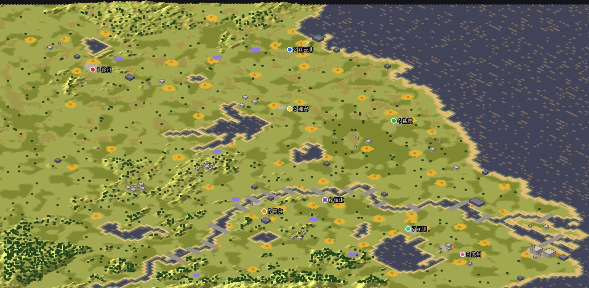

### 苏南 + 上海
南京到东海，包括太湖和长江口，长江上有 10 座真实位置的大桥，崇明是岛。按江南的湿润气候，平原以水田为主，村庄周围有树林。`maps/sunan.mpr`

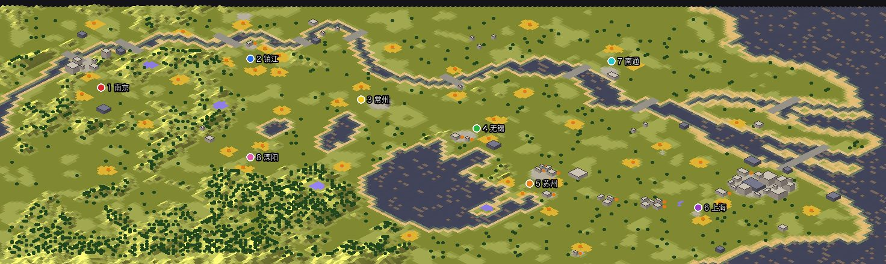

### 溧阳
长荡湖、天目湖、南山竹海，8 个乡镇围绕溧阳城区。`maps/liyang.mpr`

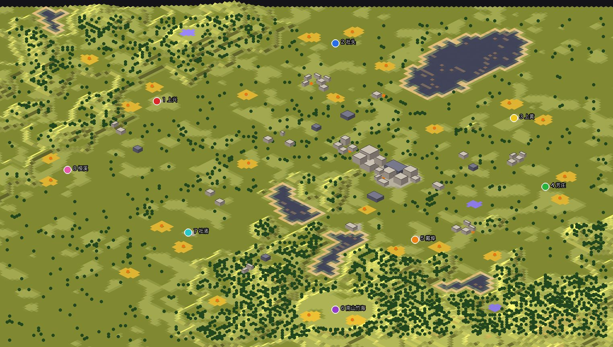

### 长城抗战 (1933)
地图西起密云，东到山海关和渤海，北边是热河的承德、滦平、宽城、青龙，南边是冀东平原。燕山做成悬崖高原，地面部队上不去；明长城按 OpenStreetMap 的走向做成山脊，除了关口以外一律是山，高原顶上能看到一段段灰色的城墙。热河和冀东之间只有五个关口，每条关道都是沿真实河谷算出的最省力路线，画成峡谷：古北口（中央军第 17 军，南天门在关内）、罗文峪和喜峰口（29 军，大刀队夜袭）、冷口（32 军）、界岭口。每个关口的城墙线上横着一道沙袋工事，中间留出关门。关口全部堵上时，热河和冀东就被完全隔开。北边四家各占一个山间盆地，盆地之间也只能走峡谷，南边四家在平原上。滦河下游是真实水面，只有迁西、迁安两个渡口和北宁铁路的滦州铁桥可以过河；北宁铁路沿海岸经昌黎、北戴河、秦皇岛通到山海关。宝石矿放在南天门、罗文峪外的半壁山、喜峰口外的潘家口（赵登禹夜袭日军炮兵阵地的地方）和九门口，开滦煤矿是油井，天下第一关是前哨站，还有承德机场。3 月的冀东还没开春，地里多是翻过的土和枯草。`maps/changcheng.mpr`

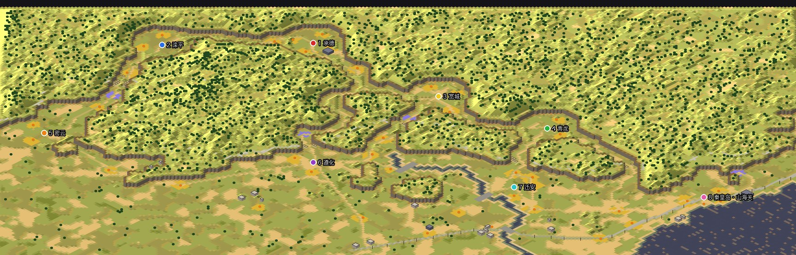

### 淞沪会战 (1937)
地图从昆山、太仓一直到长江口和杭州湾，北起浏河，南到金山卫。黄浦江（连同横潦泾、泖河、拦路港这段上游，一直通到淀山湖）、苏州河/吴淞江和蕰藻浜下游按 OpenStreetMap 的河道做成真实水面，只能从 1937 年的桥和渡口过河：苏州河上有西藏路桥（四行仓库就在北岸桥头）、梵王渡、北新泾、黄渡等 6 处，蕰藻浜上有吴淞镇和陈家行，黄浦江上有董家渡、杨树浦、龙华、闵行、米市渡、泖河 6 处渡口和石湖荡铁桥。桥全断时地图分成三块：北岸的闸北、罗店、太仓、昆山，苏州河与黄浦江之间的青浦、松江，以及黄浦江东南的浦东和金山卫，正好对应 8 月到 11 月战局的三个阶段。上海市区（租界、南市、虹口、杨树浦）是中立城区，出生点放在北边的闸北·江湾；浏河—罗店—刘行—大场—闸北这条 10 月以前的主战线两侧是弹坑和战壕，几乎没有树。铁路画了 1908 年的沪宁线、1909 年的沪杭线和北站到吴淞炮台湾的淞沪铁路，公路是沪太、沪嘉、松金等 1937 年的公路。宝石矿放在大场、宝山城（姚子青营）、浏河滩头、佘山和只能走海路或空运去的崇明岛，吴淞和狮子林炮台是前哨站，虹桥、龙华两个机场。`maps/songhu.mpr`

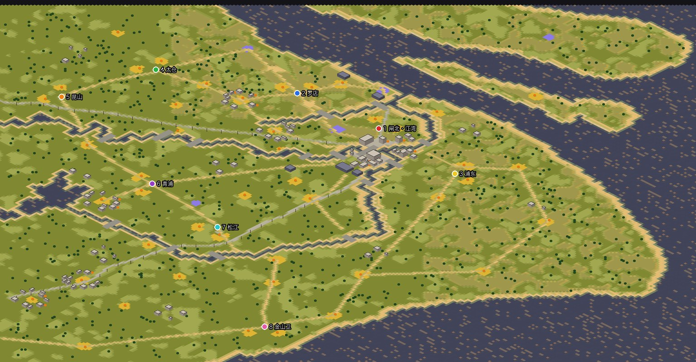

### 辽沈战役 (1948)
地图包括辽西走廊、锦州、塔山、黑山-大虎山、沈阳和被围困的长春，铁路按 1948 年的北宁线、中长线和各条支线画出。原版红警2没有铁轨地块，所以铁路用一条压平的路基（铺装地面）表示，旁边每隔 6 格立一根电线杆；路基按沿线平均高度找平，只在换高度的地方有一格坡。战役打到 11 月初，东北已经下了初雪，所以用雪地地形，地里还露着高粱茬。`maps/liaoshen.mpr`

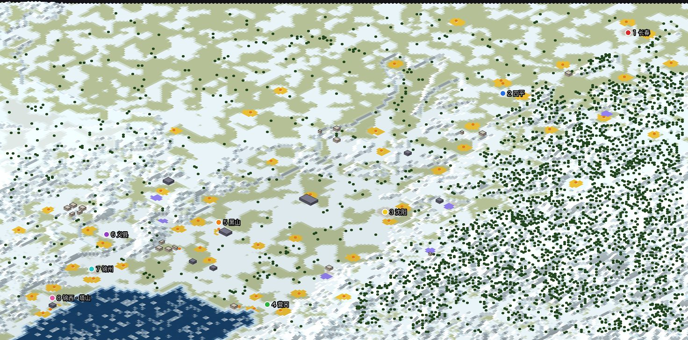

### 淮海战役 (1948-49)
以徐州为中心，津浦铁路和陇海铁路在这里交叉。碾庄、双堆集、陈官庄三个围歼地都是出生点，地图上还有微山湖、骆马湖和洪泽湖。陈官庄被围期间连降大雪，所以用雪地地形。`maps/huaihai.mpr`

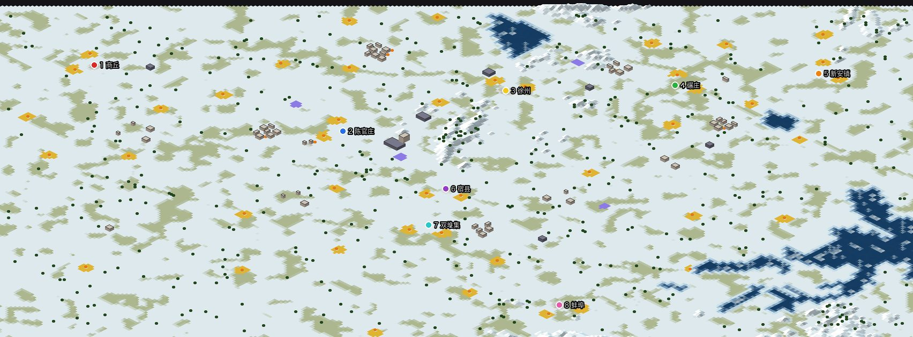

### 库尔斯克战役 (1943)
库尔斯克突出部：北面是奥廖尔和波内里，南面是别尔哥罗德、奥博扬和普罗霍罗夫卡，地形是开阔的黑土高原。`maps/kursk.mpr`

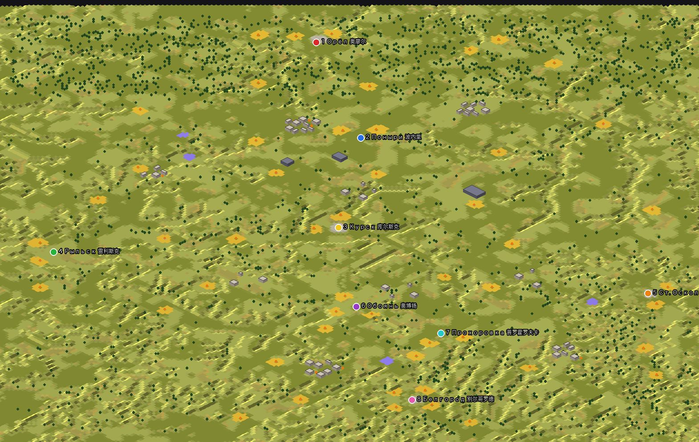

### 太原战役 (1948–49)
"表里山河"：晋中盆地被吕梁山和太行山围住，山地做成悬崖高原，地面部队上不去，进出只有四个关口：北面同蒲北段过石岭关通忻州，东面沿正太铁路通寿阳，南面介休以南的汾河峡口（晋中战役时徐向前部从临汾北上走的就是这条路），西面汾河峡谷通古交煤田。太原城东的东山四大要塞（小窑头、牛驼寨、山头、淖马）在悬崖前的低丘上，有前哨站和宝石矿，1948 年秋天决定战局的争夺就在这里。武宿机场失守后阎锡山的空运就断了。铁路画了同蒲线和正太线。`maps/taiyuan.mpr`

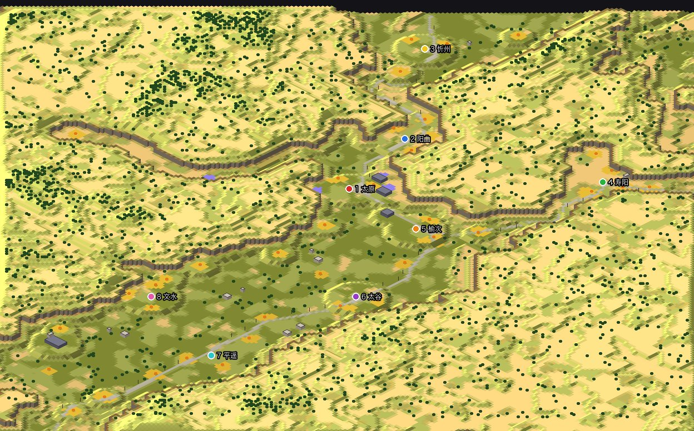

### 突出部战役 (1944)
地图从埃尔森博恩岭和施内艾费尔一直到默兹河，巴斯托涅和圣维特是全图的两个公路枢纽。阿登高原大半是密不透风的云杉林，坦克离开公路几乎寸步难行，所以按 1944 年的路网画了 34 条公路（包括派佩尔战斗群的进军路线、卢森堡的"天际线公路"和巴顿北上解围走的阿尔隆公路），谁控制路口谁就控制战场。默兹河是德军的最终目标，按 OpenStreetMap 的河道做成真实水面，只有迪南、纪韦、伊沃尔、那慕尔、昂代讷、于伊等处的桥可以过河；有一家起点在西岸。斯塔沃洛和弗朗科尔尚的燃料库（派佩尔始终没拿到的油料）是油井，Foy-Notre-Dame 标出德军最远推进点。12 月的阿登是多年来最冷的冬天，用雪地地形。`maps/ardennes.mpr`

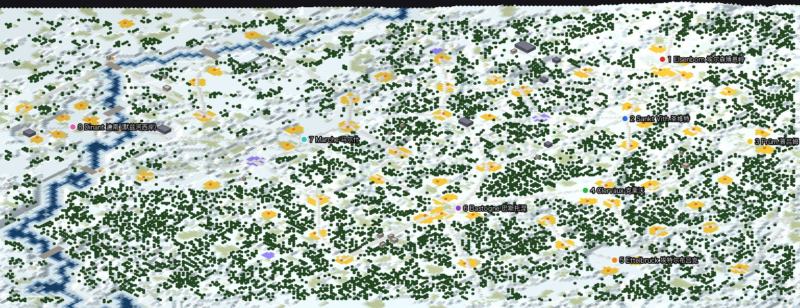

### 凡尔登战役 (1916)
地图包括马斯河谷和凡尔登城、右岸默兹高地上的杜奥蒙堡、沃堡、苏维尔堡等要塞环、左岸的死人山和 304 高地，德军一侧是蒙福孔、当维莱、埃坦和沃夫尔平原，以及横跨马斯河的圣米耶勒突出部。马斯河是真实水面，只能从 10 座桥过河；法军的生命线"神圣之路"从南边经苏伊利司令部通到凡尔登，铁路是经凡尔登通往埃坦和梅斯的干线。1916 年的战线两侧是弹坑和泥浆，几乎没有树，前线上被毁的村庄也不放房子；宝石矿放在死人山、考尔森林、莱塞帕尔热和沃夸几处争夺最激烈的高地。`maps/verdun.mpr`

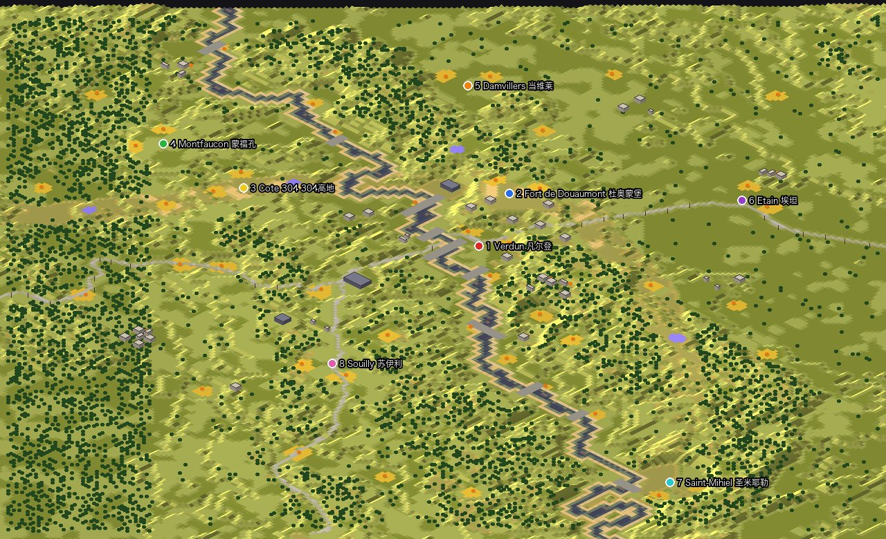

### 葛底斯堡战役 (1863)
十条大路在宾夕法尼亚的一座小镇交汇，南北两军沿着这些路走来，在这里撞上了。地图包括"鱼钩"阵地（卡尔普山—公墓山—公墓岭—圆顶山）、对面的神学院岭和皮克特冲锋走过的那片开阔田野，西北是橡树山和 McPherson 岭，西边是南山脚下的卡什敦。真实高差只有约 40 m，所以把几座关键山头的起伏放大了几倍，让卡尔普山、小圆顶、大圆顶能从田野里明显凸出来，农田则基本保持平坦，方便展开部队。12 条历史道路按 OSM 路线画成土路，东去汉诺威的铁路画成路基加电线杆，小镇以西未铺轨的"铁路路堑"画成土路。宝石矿放在高水位线、魔鬼穴、Benner's Hill 等处，桃园和麦田一带是农庄。`maps/gettysburg.mpr`

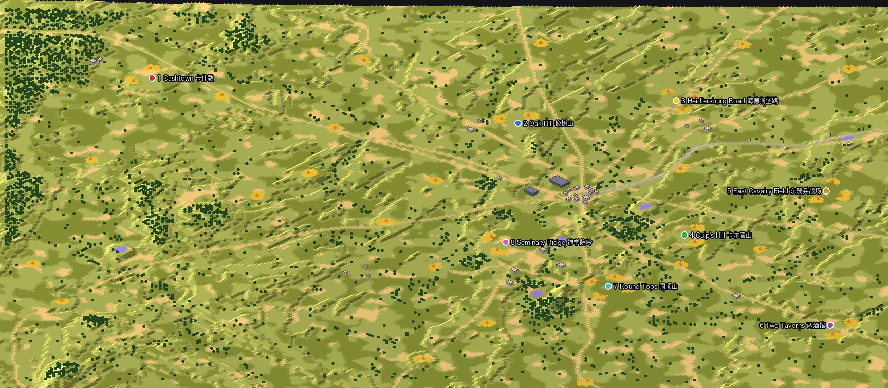

### 楚汉争霸 1：还定三秦 (前 206)
"明修栈道，暗度陈仓"：秦岭做成悬崖高原，地面部队上不去，汉中和关中之间只有四条古道可走，都是沿真实河谷画出的峡谷——故道（陈仓、散关、凤县、嘉陵江、略阳到沔阳，韩信真正走的路）、褒斜道（斜谷、太白、褒谷到石门，被烧掉的栈道，也是最窄的一条）、傥骆道和子午道，四条路在山里互不相通。汉中盆地有南郑、城固、沔阳三家，关中平原上是陈仓、郿和三秦王的都城废丘（章邯）、栎阳（司马欣），以及刚被项羽烧毁的咸阳。每条古道中段放一处宝石矿（大散关、太白、华阳、宁陕），斜谷关、子午关和石门是前哨站。`maps/chuhan1_sanqin.mpr`

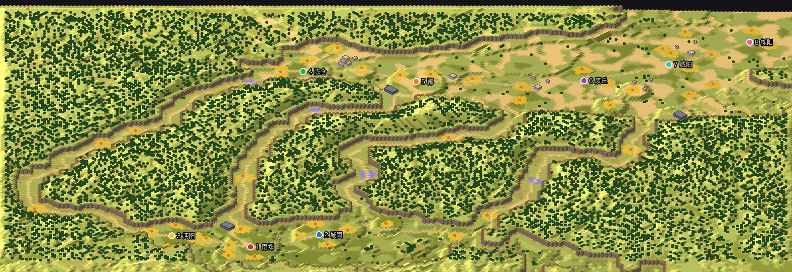

### 楚汉争霸 2：彭城之战 (前 205)
刘邦率五十六万诸侯联军攻下西楚都城彭城，项羽从齐地率三万骑兵回救，经鲁、胡陵绕到萧，拂晓从西面杀来，汉军被挤进谷水、泗水，又向南逃进山里，最后在灵壁以东的睢水边全线崩溃，"睢水为之不流"。河道按当时的走向画出：泗水从胡陵经沛、留、彭城、吕梁到下邳和下相，获水从下邑、萧流到彭城入泗，睢水从芒经相、竹邑、取虑、睢陵到下相，三条都是真实水面，只有 14 处桥和渡口可以过河，桥全断时地图分成四块。后来黄河夺泗留下的废黄河、微山湖和骆马湖当时都还不存在，平原做成一整块平地；只有萧县南面的皇藏峪、彭城周边的小山和东北的鲁南丘陵有树林和高度。宝石矿放在芒砀山、皇藏峪、大泽乡、下邳圯桥和吕梁洪。`maps/chuhan2_pengcheng.mpr`

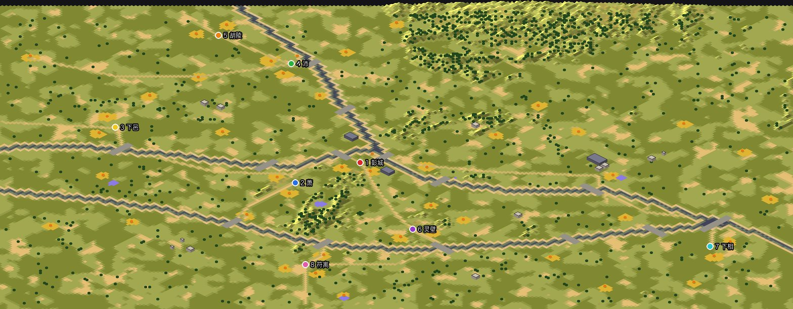

### 楚汉争霸 3：井陉之战 (前 204)
韩信东下太行，走的是"车不得方轨，骑不得成列"的井陉道；陈余拥兵井陉口，不听李左车断其粮道之计。太行做成悬崖高原，井陉道是一条约 25 km 长、只有五六格宽的山路，沿绵河北岸穿过峡谷，河水紧贴南侧的悬崖。出了峡谷，绵蔓水（今冶河）在井陉盆地里折向北流，大军必须从微水或威州渡河，才能背水列阵、再出井陉口；另有一条只有三格宽的抱犊间道翻过抱犊山，直通赵营旁的赵壁——韩信的两千轻骑就是从这里"拔赵帜，立汉赤帜"。河水从桃河、绵河、绵蔓水一直流到滹沱河，横贯全图，东垣、灵寿在平原上，陈余最后死在泜水。`maps/chuhan3_jingxing.mpr`

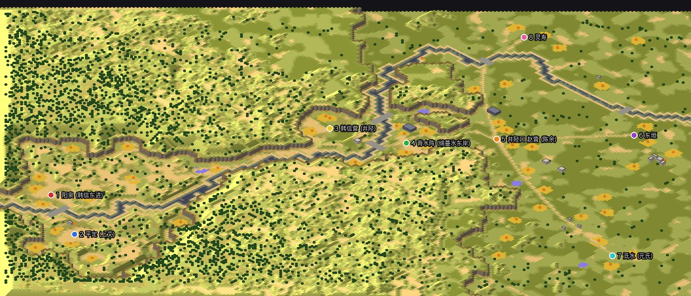

### 楚汉争霸 4：成皋之战与鸿沟 (前 204–203)
刘邦和项羽在荥阳、成皋（虎牢关）一带相持两年，争夺黄河边敖山上的敖仓。两军隔着广武山上的广武涧对垒，汉王城在涧西，霸王城在涧东；公元前 203 年双方约定"中分天下，割鸿沟以西者为汉，以东者为楚"，这就是象棋盘上的楚河汉界。地图上广武涧和鸿沟连成一条从黄河一直通到南边的水线，汉在南面和西面，楚在北面和东面，过河只有荥阳东、官渡、陈留南三处。黄河按当时的河道画：广武以西和今天一样，以东折向东北流往白马津，只有成皋北的玉门津可以渡到北岸的河内（刘邦就是从这里北渡去修武）。嵩山、浮戏山和邙山是悬崖高原，巩往东只能走黄河与悬崖之间的虎牢道。敖仓是宝石矿，道路都是土路。`maps/chuhan4_honggou.mpr`

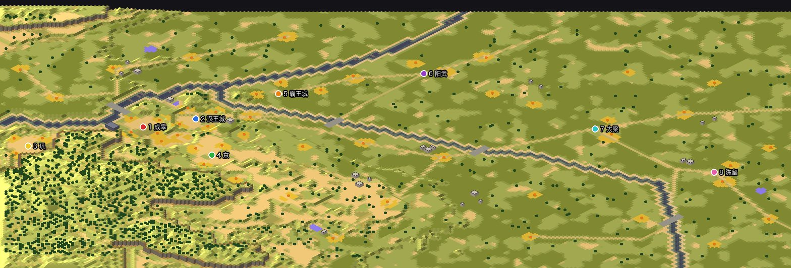

### 楚汉争霸 5：潍水之战 (前 203)
韩信破齐之后，楚将龙且率二十万楚齐联军隔潍水与汉军对峙。韩信夜里用一万多个沙袋在上游堵住河水，带兵涉浅水过河，佯败退回，等龙且的大军一半下到河床，再掘开沙坝放水，龙且战死，齐王田广逃往城阳。地图上潍水从东武一直流到莱州湾，是真实水面，只能从下密、淳于、韩信渡、东武四处浅滩过河（公元前 203 年没有桥）；韩信坝和龙且营标在韩信渡两侧。西边是齐都临淄和汉军所在的平寿，东边是高密、即墨、夜邑，南边绕过潍水源头可到城阳（莒）。道路是齐国古道和秦始皇东巡走过的琅琊道，宝石矿放在莱州湾盐场、穆陵关、琅琊和大泽山。峡山水库等现代水库、宋代的小清河和元代的胶莱运河都没有画。`maps/chuhan5_weishui.mpr`

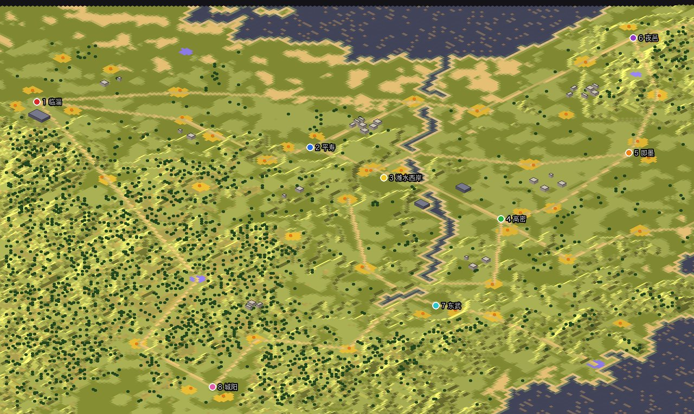

### 楚汉争霸 6：垓下之战 (前 202)
十二月的淮北，项羽被韩信、刘邦、彭越、英布四面合围在垓下，夜闻四面皆楚歌。地图从垓下、灵璧、符离一直到长江边的乌江，五路汉军和项羽各占一个起点，南边的钟离、东城、乌江是项羽突围南走的路线。淮水是真实水面，只有下蔡、荆涂峡、钟离等五处渡口，渡口一断淮北淮南就被隔开；阴陵以南是冰冻的大泽和水塘（"田父绐曰左，乃陷大泽中"）。项羽南走的路线（垓下—钟离渡淮—阴陵—东城—乌江）和十条古道画成土路。东南角是宽阔的长江，乌江亭只有一处渡口通往江东，对岸的江东宝石矿只有从这里才能过去。用雪地地形和冬夜的冷光。`maps/chuhan6_gaixia.mpr`

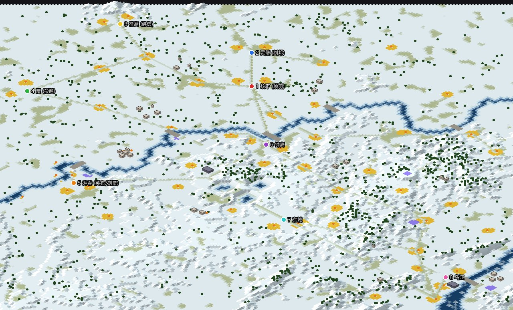

### 反攻西伯利亚（架空）
假想中国从三江平原渡过黑龙江和乌苏里江，反攻 1858 年《瑷珲条约》和 1860 年《北京条约》割给俄国的外东北（俄罗斯远东，中文里常笼统叫西伯利亚）。地图西起佳木斯、萝北，东到伯力（哈巴罗夫斯克），北到比罗比詹，南到乌苏里江边的饶河。中国一方是萝北、富锦、饶河、抚远，俄国一方是比罗比詹、列宁斯阔耶、伯力、维亚泽姆斯基。黑龙江、乌苏里江和松花江按 OpenStreetMap 的主航道做成真实水面，只能从 9 处桥和口岸过河：黑龙江上有嘉荫—帕什科沃、名山—阿穆尔泽特、同江中俄铁路大桥、抚远港和伯力阿穆尔大桥，乌苏里江上有饶河—波克罗夫卡，松花江上有富绥大桥，另外两座桥连着黑瞎子岛。黑瞎子岛（2008 年中俄平分）是江心的一块独立陆地，中国一侧走乌苏大桥上岛，俄国一侧从贝奇哈过桥上岛；按真实宽度它只有两格宽，所以把两边的河道各往外推了约 3 km。伯力阿穆尔大桥是伯力一岸和犹太自治州之间唯一的通道。桥全断时地图分成五块：犹太自治州、伯力和乌苏里江东岸、三江平原、松花江与黑龙江之间的萝北，以及黑瞎子岛。宝石矿放在黑瞎子岛、萝北云山石墨矿、太平沟金矿、双鸭山煤矿和沃洛恰耶夫卡（1922 年远东内战的战场）。铁路画了西伯利亚大铁路（经比罗比詹到伯力，再沿乌苏里江东岸南下）、佳富—福前—前抚线，以及同江经铁路大桥到列宁斯阔耶、比罗比詹的支线。小兴安岭、犹太自治州的山地和完达山是落叶松和云杉林，平原上是国营农场和湿地。时间是 11 月初，下了初雪，江还没有封冻。`maps/siberia.mpr`

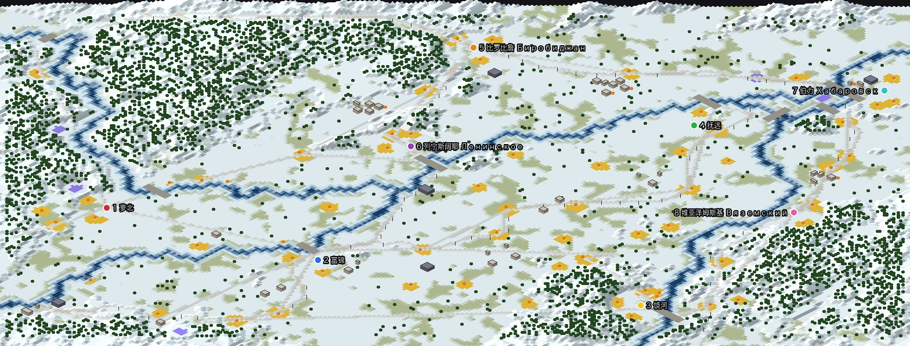

### 呼和浩特
大青山、土默川平原和黄河。`maps/hohhot.mpr`

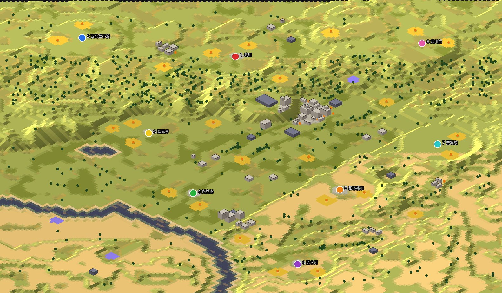

### Colorado
整个科罗拉多州：东半部是大平原，西半部是落基山脉。落基山被做成一整块高原，四周是游戏原版的悬崖块，比周围高 4 级，往里一直升到 13 级（游戏上限是 14 级）。地面部队上不去也翻不过，东西两边只有三条路相通：
- **I-70**（中线）：丹佛 → Idaho Springs → Eisenhower 隧道 → Vail → Glenwood 峡谷 → Grand Junction
- **北线**：Loveland → Estes Park → Trail Ridge Road（落基山国家公园）→ Granby → Kremmling → Rabbit Ears 山口 → Steamboat Springs
- **南线 US-160**：Walsenburg → La Veta 山口 → 圣路易斯谷（Alamosa）→ Wolf Creek 山口 → Pagosa Springs → Durango

每条路都是两侧夹着悬崖的峡谷，路面约 7 格宽，三条路在山里互不相通。山口上有宝石矿（Idaho Springs、Frisco、Lulu City、Summitville），所以过山的路本身就值得争夺。东边 4 家（Boulder、Colorado Springs、Sterling、Lamar），西边 3 家（Grand Junction、Durango、Steamboat Springs），Alamosa 一家在圣路易斯谷里，只能走南线进出。`maps/colorado.mpr`

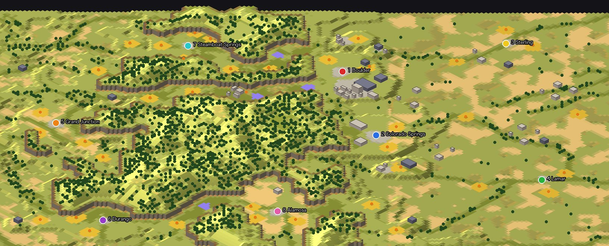

### San Francisco Bay Area
旧金山湾区，使用城市地形，有城市街区和地标建筑。`maps/bayarea.mpr`

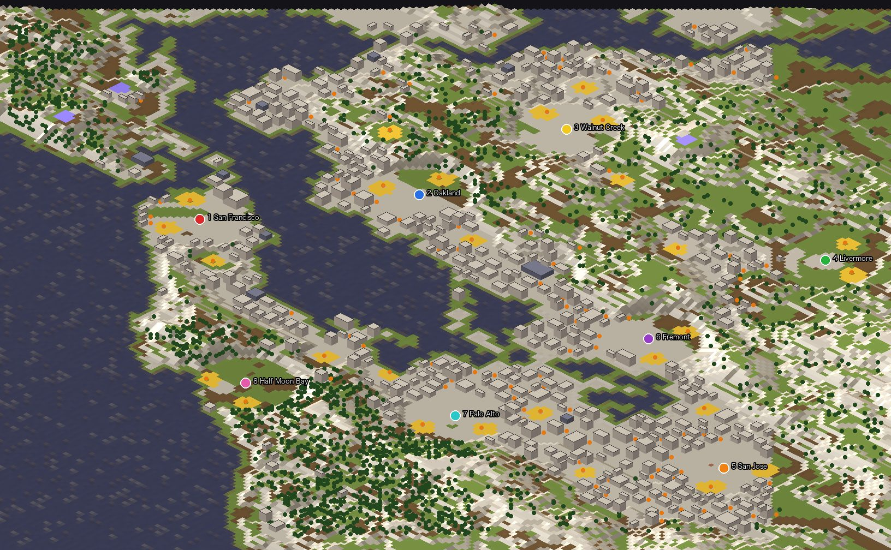

## 自己生成

```sh
python3 gen.py jiangsu          # 生成 out/jiangsu/jiangsu.mpr 和预览图
python3 validate.py out/jiangsu/jiangsu.mpr
python3 render.py jiangsu 4     # 渲染上面那样的斜视图
```

每张地图的设置都在 `regions/<name>.py` 里，包括范围、出生点、矿区、城市、道路、水面和桥梁。依赖 numpy、Pillow 和 matplotlib。

仓库里没有 `data/` 和 `ref/` 两个目录，需要自备：

- `data/`：高程瓦片和 OSM 数据。
- `ref/`：游戏的地形集定义（温带、城市、雪地，来自 OpenRA 的红警 2 项目）、官方地图样本，以及 FinalAlert 2 的源码。

每张地图用哪种游戏地形，由 `regions/<name>.py` 里的 `THEATER` 设置，目前支持温带、城市和雪地。

山地可以做成悬崖围起来的高原（Colorado、太原、还定三秦、井陉、鸿沟、长城抗战用到，只支持温带）。设置方法是在 region 里写一个 `plateau(g)` 函数，返回山地范围、必须保持平地的格子和必须保持山地的格子。`cliffs.py` 负责沿高原边缘铺悬崖块：先从官方温带地图里统计出每两种悬崖块在四个方向上能否相邻（`learn_cliffs.py` 统计，结果存进 `cliff_rules.json`），再用约束传播加回溯，求出一组所有相邻关系都在官方地图里出现过的铺法。遇到太窄的山脊或缺口铺不下时，就把那一小块的轮廓修圆一些再重试。`validate.py` 会复查生成结果里每一对相邻的悬崖块。`connectivity.py` 把悬崖当作不可通行的格子处理；如果设置了 `BLOCK=I-70,US-160`，它会把这几条山口封掉后再检查各出生点之间是否连通。

region 里还可以写一个 `walls(g)` 函数，返回要放墙的格子，生成器会在这些格子上放官方地图里的沙袋墙，并按官方地图的写法填好每格和相邻墙的连接方式（长城抗战用它在关口横一道沙袋）。

过河的桥按 region 里的 `BRIDGES` 位置放，默认要求桥两头是两块互不相连的陆地；河在地图中间就到头时（如蕰藻浜在南翔以西就没有了），可以设置 `BRIDGE_DETOUR`，只要从陆地上绕过去（不能走悬崖和高原）要走的格数超过这个值，也允许建桥。

铁路和道路可以画在地上：region 里的 `RAILWAYS` 画成铺装路基，旁边每隔 6 格立一根电线杆（原版红警 2 没有铁轨地块）；`TRACKS` 画法相同但不立电线杆，地面用 `TRACK_COVER`（如 `'SAND'` 土路、`'PAVE'` 铺装路）。路基按沿线平均高度找平，只在换高度的地方有一格坡，路上不放树、矿和建筑。
